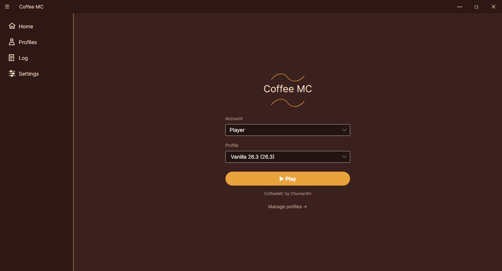

# CoffeeMC - MC launcher

[](https://dotnet.microsoft.com/en-us/download/10.0)
[](https://avaloniaui.net)
[](LICENSE)

RU **[Читать на русском](README_ru.md)**

A lightweight, cross-platform Minecraft launcher built with **C#**, **Avalonia UI**, and **.NET 10**. Designed as a modern, native-feeling alternative without heavy dependencies like Qt.

## ✨ Features

* **Cross-Platform:** Runs natively on Windows, Linux, and macOS thanks to Avalonia UI.
* **High Performance:** Compiled with .NET 10 for fast startup and low memory footprint.
* **Authentication:** [Microsoft Account / Offline mode]
* **Version Management:** Easy installation and launching of Vanilla, Forge, Fabric, and NeoForge versions.
* **Modpack & Instance Support**

## 🚀 Getting Started

### Prerequisites
* [.NET 10 SDK](https://dotnet.microsoft.com/ru-ru/download/dotnet/10.0) (for building from source)
* Java 8 / 17 / 21 (depending on the Minecraft version you want to play)

### Installation (Release)
1. Go to the [Releases](../../releases) page.
2. Download the archive for your OS (`win-x64`).
3. Extract and run the executable.

### Building from Source
```bash
git clone https://github.com/thechumersh/CoffeeMC.git
cd CoffeeMC
dotnet run
```

To publish a standalone executable:
```bash
dotnet publish -r win-x64 -c Release /p:PublishSingleFile=true --self-contained true /p:IncludeNativeLibrariesForSelfContained=true
```

## 🛠️ Tech Stack

* **Language:** C# 14
* **Framework:** .NET 10
* **UI Framework:** Avalonia UI

## ⚙ Supports any OS (official .NET-based SDK 10 support)
* **Windows:** 10 (1607)
* **Linux:** kernel 4.18 / 5.4 - Debian 13, Ubuntu 22.04 LTS (22.04 & 26.02), and others
* **MacOS:** 14 (sonnara) and above

## 📝 License

This project is licensed under the [MIT License](LICENSE).

---
*Disclaimer: Not an official Minecraft product. Not approved by or associated with Mojang or Microsoft.*
