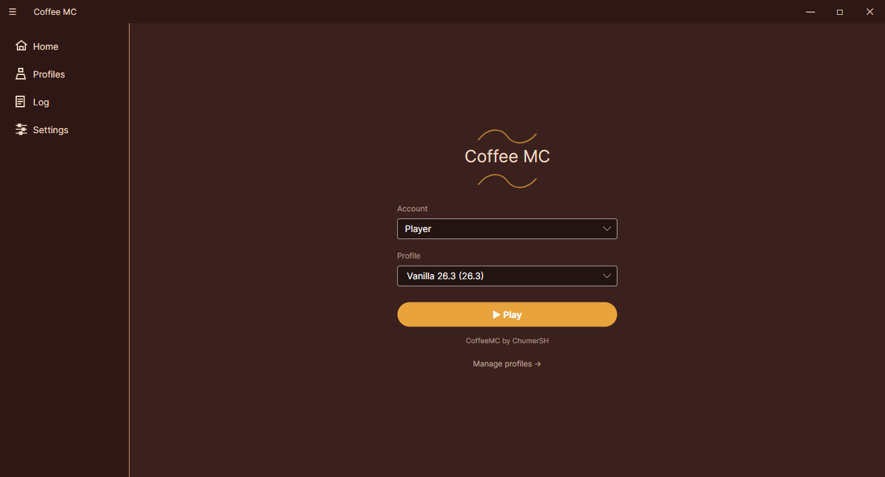

# CoffeeMC - MC launcher

[](https://microsoft.com)
[](https://avaloniaui.net)
[](LICENSE)

🇬🇧 **[Read in English](README.md)**

Легкий кроссплатформенный лаунчер для Minecraft, написанный на **C#**, **Avalonia UI** и **.NET 10**. Создан как современная и нативная альтернатива без тяжелых зависимостей вроде Qt.

## ✨ Основные возможности

* **Кроссплатформенность:** Нативно работает на Windows, Linux и macOS благодаря Avalonia UI.
* **Высокая производительность:** Скомпилирован с помощью .NET 10 для быстрого запуска и минимального потребления памяти.
* **Авторизация:** Аккаунт Microsoft / Оффлайн-режим
* **Управление версиями:** Простая установка и запуск версий Vanilla, Forge, Fabric и NeoForge.
* **Поддержка сборок и профилей**

## 🚀 Начало работы

### Требования
* [.NET 10 SDK](https://microsoft.comdownload/dotnet/10.0) (для сборки из исходного кода)
* Java 8 / 17 / 21 (в зависимости от версии Minecraft, в которую вы хотите играть)

### Установка (Готовая сборка)
1. Перейдите на страницу [Releases](../../releases).
2. Скачайте архив для вашей ОС (`win-x64`).
3. Распакуйте и запустите исполняемый файл.

### Сборка из исходного кода
```bash
git clone https://github.com
cd CoffeeMC
dotnet run
```

Для компиляции автономного (standalone) исполняемого файла:
```bash
dotnet publish -r win-x64 -c Release /p:PublishSingleFile=true --self-contained true /p:IncludeNativeLibrariesForSelfContained=true
```

## 🛠️ Стек технологий

* **Язык:** C# 14
* **Платформа:** .NET 10
* **UI Фреймворк:** Avalonia UI

## 📝 Лицензия

Проект распространяется под лицензией [MIT License](LICENSE).

---
*Отказ от ответственности: Не является официальным продуктом Minecraft. Не одобрено Mojang или Microsoft и не связано с ними.*
